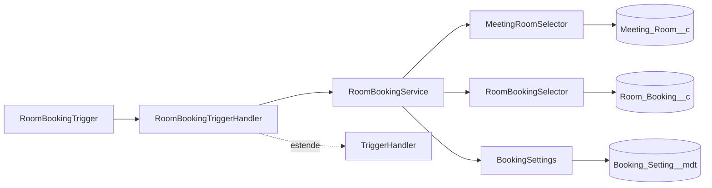
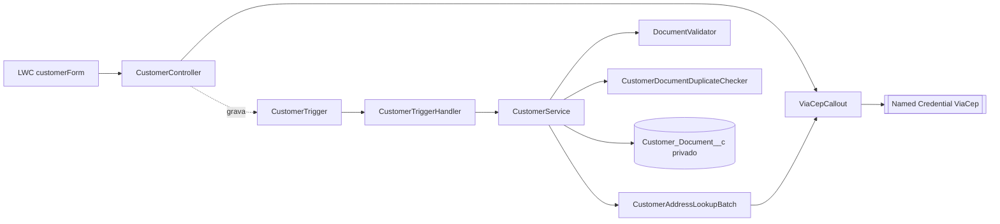

# estudos27 — Salesforce com Spec-Driven Development

Projeto de estudos em Salesforce (Apex, LWC, Flows e metadata) desenvolvido com
**Spec-Driven Development (SDD)** e apoio do [Claude Code](https://claude.com/claude-code).
Cada funcionalidade nasce de uma especificação aprovada, vira um plano técnico, é
implementada com testes primeiro e só é entregue com evidência de verificação.

Mesmo sendo uma org de estudos (Developer Edition), o código segue práticas de projeto
real: bulkificação, segurança (sharing, CRUD/FLS), padrão Trigger Handler, testes com
carga de 200 registros e deploy validado antes de ir para a org.

## Como o trabalho é feito

A **Constituição** (princípios e disciplina de escopo) fica no [`AGENTS.md`](AGENTS.md),
compartilhada por Claude Code e Kiro. O processo está no [`CLAUDE.md`](CLAUDE.md) (Claude
Code) e em [`.kiro/steering/sdd-process.md`](.kiro/steering/sdd-process.md) (Kiro). Em
resumo:

```
0. Contexto → 1. Spec → 1.5 Dúvidas → [aprovação] → 2. Plan → [aprovação]
            → 3. Tasks → 4. Implementação (testes primeiro) → 5. Verificação → [deploy]
```

| Documento  | Responde                | Conteúdo                                                                                                                                        |
| ---------- | ----------------------- | ----------------------------------------------------------------------------------------------------------------------------------------------- |
| `spec.md`  | **O quê** e **por quê** | Requisitos no formato "QUANDO/SE … O SISTEMA DEVE …", critérios de aceite (Dado/Quando/Então), fora de escopo, histórico de mudanças            |
| `plan.md`  | **Como**                | Decisão Flow × Apex × LWC, modelo de dados, segurança, inventário de metadata, orçamento de governor limits, plano de testes rastreável, riscos |
| `tasks.md` | **Passos**              | Tarefas pequenas e verificáveis, cada uma ligada a um requisito, marcadas conforme são concluídas                                               |

Princípios que valem em todo código (a Constituição do `AGENTS.md`):

- `with sharing` por padrão; `without sharing` só com justificativa.
- Um trigger por objeto, sem lógica, delegando a um handler; service e selector só quando
  há reúso ou mais de um objeto.
- Nunca SOQL ou DML dentro de loops.
- CRUD/FLS respeitados com `WITH USER_MODE` / `AccessLevel.USER_MODE`.
- Todo Apex com classe de teste: `@TestSetup`, `Assert` com mensagem, cenários positivo,
  negativo, carga (200+) e `System.runAs`.
- Textos em Custom Labels, acesso por Permission Set; Custom Metadata só para o que a
  spec pede como configurável.
- Implementar só o que está na spec aprovada; regra de negócio em dúvida vira pergunta.
- Rastreabilidade de ponta a ponta: requisito → critério de aceite → teste → commit.

## Projetos

| #   | Projeto                               | Status                                       | Documentos                                                                                                                                         |
| --- | ------------------------------------- | -------------------------------------------- | -------------------------------------------------------------------------------------------------------------------------------------------------- |
| 001 | Reserva de salas de reunião           | Implementado                                 | [spec](specs/001-meeting-room-booking/spec.md) · [plan](specs/001-meeting-room-booking/plan.md) · [tasks](specs/001-meeting-room-booking/tasks.md) |
| 002 | Cadastro de clientes com busca de CEP | Implementado                                 | [spec](specs/002-customer-cep-lookup/spec.md) · [plan](specs/002-customer-cep-lookup/plan.md) · [tasks](specs/002-customer-cep-lookup/tasks.md)    |
| —   | Projeto (`Project__c`)                | Exercício anterior ao processo SDD, sem spec | —                                                                                                                                                  |

### 001 — Reserva de salas de reunião

Colaboradores reservam salas sem conflito de horário; administradores gerenciam as salas.

- **Regras:** sem sobreposição na mesma sala (o fim é exclusivo, então reservas encostadas
  são permitidas), capacidade, horário de funcionamento em dias úteis no fuso de quem
  reserva, duração de 15 min a 4 h, sem reservas no passado e até 90 dias à frente
  (limites configuráveis), cancelar e reativar, "o primeiro do lote vence" em cargas em
  massa, revalidação ao restaurar da Lixeira.
- **Acesso:** todos veem todas as salas e reservas; cada organizador edita, cancela e exclui
  só as próprias; o administrador gerencia tudo.
- **Qualidade:** 55 testes Apex, cobertura ≥ 99,6% por classe, 38 critérios de aceite
  rastreados, revisão de código com correções registradas no `tasks.md`.



### 002 — Cadastro de clientes com busca de CEP

Cadastro de clientes com endereço preenchido pelo CEP (ViaCEP) e CPF/CNPJ protegido.

- **Busca de CEP:** na tela (LWC), automática ao completar 8 dígitos, com cidade e UF
  travadas; CEP inexistente impede salvar; com o serviço fora do ar, o endereço é digitado
  à mão. Em importações, um Batch em segundo plano completa só os campos vazios e apaga
  CEPs inexistentes com uma observação.
- **CPF/CNPJ:** obrigatório, validado pelos dígitos verificadores (inclusive o **CNPJ
  alfanumérico**), sem duplicidade e visível **só para quem cadastrou e para o
  administrador**, graças a um objeto separado com compartilhamento privado.
- **Acesso:** todos veem os clientes; quem cadastrou edita e exclui; o administrador
  gerencia todos.
- **Qualidade:** 52 testes Apex (cobertura de 93,2% a 100% por classe), 25 testes Jest, 31
  critérios de aceite rastreados; a revisão de código encontrou e corrigiu um bloqueador
  (limite de 5 Queueables encadeados na Developer Edition → Batch Apex); busca real
  conferida pela org.



## Estrutura do repositório

```
force-app/main/default/   Metadata do Salesforce (objetos, Apex, triggers, LWC, permission sets…)
specs/                    Uma pasta por funcionalidade: spec.md, plan.md, tasks.md
agent_docs/               Regras de negócio, segurança, padrões de engenharia e produtividade
.claude/rules/            Convenções por tipo de arquivo (Apex, LWC, Flows, geral)
.claude/agents/           Revisores automáticos de Apex e LWC (somente leitura)
.claude/commands/         Comandos /review-apex, /review-flow, /gen-test, /deploy-check, /debug-log,
                          /create-callout, /create-lwc
.claude/settings.json     Hook que bloqueia commit se lint ou testes LWC falharem
.kiro/steering/           Processo SDD e regras de código para o Kiro
scripts/apex/             Scripts de Apex anônimo (inclui as massas de dados das specs 001 e 002)
CLAUDE.md                 Processo SDD no Claude Code
AGENTS.md                 Constituição compartilhada (Claude Code, Kiro, Agentforce Vibes)
```

### Ferramentas de revisão (Claude Code)

| Ferramenta        | Tipo    | O que faz                                                                                                                        |
| ----------------- | ------- | -------------------------------------------------------------------------------------------------------------------------------- |
| `apex-reviewer`   | Agente  | Revisa Apex e triggers contra as regras do projeto (limites, bulk, segurança, framework de trigger, testes). Só lê, nunca edita. |
| `lwc-reviewer`    | Agente  | Revisa componentes LWC (LDS × Apex, tratamento de erro, segurança, SLDS/acessibilidade, testes Jest). Só lê, nunca edita.        |
| `/review-apex`    | Comando | Code review de Apex com tabela por severidade (Crítico / Alerta / Melhoria).                                                     |
| `/review-flow`    | Comando | Auditoria de Flows: DML/SOQL em loop, fault connectors, recursão.                                                                |
| `/gen-test`       | Comando | Gera classe de teste Apex com `@TestSetup`, cenários positivo/negativo e carga de 200+.                                          |
| `/deploy-check`   | Comando | Verificação de pré-deploy: git, dry-run e testes.                                                                                |
| `/debug-log`      | Comando | Analisa logs de Apex: exceções, governor limits e recursão.                                                                      |
| `/create-callout` | Comando | Gera uma integração REST de saída: service, wrappers, exceção, `HttpCalloutMock` e testes.                                       |
| `/create-lwc`     | Comando | Gera um LWC completo com controller Apex, teste Apex e teste Jest.                                                               |

Nas specs 001 e 002, os revisores encontraram problemas reais que foram corrigidos antes do
deploy (registrados nos `tasks.md`).

## Como rodar

**Pré-requisitos:** [Salesforce CLI](https://developer.salesforce.com/tools/salesforcecli),
Node.js e uma org Developer Edition autenticada com o alias `estudos27`.

```bash
# Ferramentas (ESLint, Prettier, Jest, Husky)
npm install

# Autenticar a org
sf org login web --alias estudos27

# Validar um deploy sem salvar nada (sempre antes do deploy real)
sf project deploy start --source-dir force-app/main/default/objects/Room_Booking__c \
  --target-org estudos27 --dry-run

# Testes Apex da spec 001, com cobertura
sf apex run test --target-org estudos27 \
  --class-names RoomBookingServiceTest --class-names RoomBookingSecurityTest \
  --class-names MeetingRoomValidationTest --class-names TriggerHandlerTest \
  --class-names BookingSettingsTest --code-coverage --result-format human --wait 10

# Testes Apex da spec 002, com cobertura
sf apex run test --target-org estudos27 \
  --class-names CustomerServiceTest --class-names CustomerSecurityTest \
  --class-names CustomerControllerTest --class-names CustomerAddressLookupBatchTest \
  --class-names DocumentValidatorTest --class-names ViaCepCalloutTest \
  --code-coverage --result-format human --wait 10

# Lint e testes de LWC
npm run lint && npm test
```

### Massa de dados para testar a spec 001

Cria 10 salas e 200 reservas válidas (todas passam pelas regras do trigger). O usuário
precisa do Permission Set `Meeting_Room_Admin`.

```bash
sf apex run --file scripts/apex/seed-001-meeting-room-booking.apex --target-org estudos27
# para remover só esses dados:
sf apex run --file scripts/apex/cleanup-001-meeting-room-booking.apex --target-org estudos27
```

### Massa de dados para testar a spec 002

Cria 200 clientes gravados como numa importação: o Batch busca os CEPs no ViaCEP real e
completa os endereços em segundo plano. Inclui CEPs inexistentes, clientes sem CEP, CPFs e
CNPJs (também alfanuméricos). O usuário precisa do Permission Set `Customer_Admin`.

```bash
sf apex run --file scripts/apex/seed-002-customers.apex --target-org estudos27
# para remover só esses dados:
sf apex run --file scripts/apex/cleanup-002-customers.apex --target-org estudos27
```

## Convenções

- Commits no padrão [Conventional Commits](https://www.conventionalcommits.org/)
  (`feat:`, `fix:`, `docs:`, `chore:`…), citando a spec quando houver
  (`feat: 002 customer CEP lookup`).
- Mudanças entram por pull request; o deploy é sempre escopado aos componentes da spec.
- Formatação feita pelo Prettier no pre-commit (Husky + lint-staged).
- Documentação e mensagens ao usuário em português; código e nomes de API em inglês.
